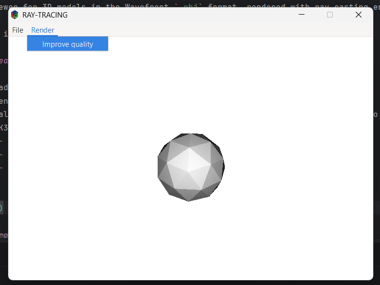

# ray_casting

A viewer for 3D models in the Wavefront `.obj` format, rendered with ray casting entirely on the CPU. Written in C with a GTK3 graphical interface.

This is a university project.

## Features

- Loading `.obj` files (parser in `objParser/`)
- Scene rendering using ray casting (ray–triangle intersection)
- Quality improvement: the render starts at a low resolution with a possibility to rerender the image with better quality later
- GTK3 interface with a menu bar:
    - **File → Open...**: choose an `.obj` file to display
    - **File → Quit**: close the application
    - **Render → Improve quality**: perform the next render with improved quality




## Project structure

```
.
├── CMakeLists.txt
├── src/
│   ├── main.c
│   ├── geometry/       # vectors, matrices, triangles, rays      (geom library)
│   ├── utf8/           # UTF-8 handling                          (utf8 library)
│   ├── collections/    # array list, stack, queue                (coll library)
│   ├── utils/          # helper functions                        (util library)
│   ├── objParser/      # .obj file parser
│   └── gui/            # window, drawing, rendering              (draw.c, window.c, render.c)
├── sample/             # sample .obj models to try out the viewer
└── bin/                # build output (created during the build)
```

The `geom`, `utf8`, `coll` and `util` libraries are built as shared libraries (`SHARED`), and `geom` is linked against `util`. The executable links everything together with GTK3 and the math library `m`.

## Requirements

- C compiler (GCC or Clang)
- CMake ≥ 3.5
- `pkg-config`
- GTK+ 3 (development headers)

## Building

```bash
mkdir build
cd build
cmake ..
make
```

Output files are placed in the `bin/` directory in the project root:

- `bin/ray_casting`: the application
- `bin/lib/`: shared libraries (`libgeom.so`, `libutf8.so`, `libcoll.so`, `libutil.so`)

## Running

```bash
./bin/ray_casting
```

If the system can't find the shared libraries, run with the library path set:

```bash
LD_LIBRARY_PATH=bin/lib ./bin/ray_casting
```

Then choose **File → Open...** and select an `.obj` file. For a more accurate image, use **Render → Improve quality** (it can be repeated).

## Samples

The `sample/` directory contains example `.obj` models you can use to try out the viewer. Open any of them via **File → Open...**, for example:

```
sample/cube.obj
sample/shpere.obj
sample/monkey.obj
```

## Limitations

- Rendering runs on the CPU only and is slow for larger models
- Only the `.obj` format is supported

## Ideas for future development

- Multithreaded rendering
- Camera controls (rotation, zoom)
- Material (`.mtl`) and texture support
- Saving the rendered image to a file

## License

This project is licensed under the [MIT License](LICENSE).